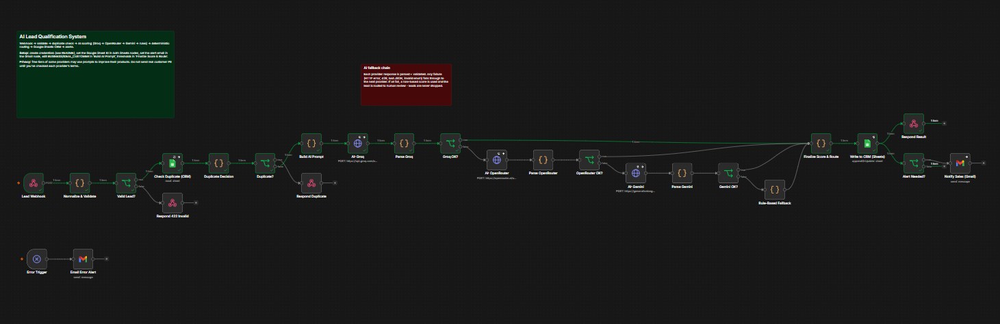
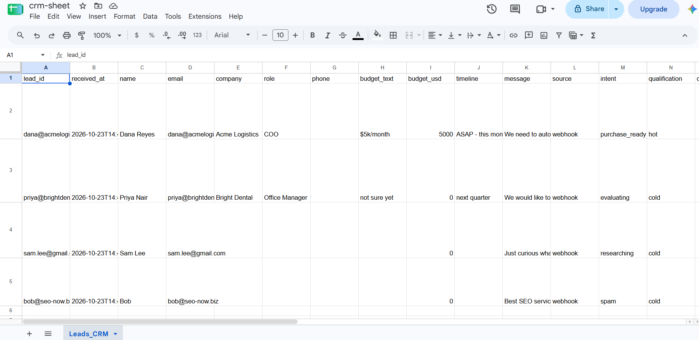

# AI Lead Qualification System (n8n)

An n8n automation workflow that receives leads via webhook, validates them, checks for duplicates, scores them using AI with provider fallback, and routes qualified leads to a Google Sheets CRM with email alerts for high-priority opportunities.

## Overview

This workflow automates the lead qualification process by:

1. Receiving leads through a secured webhook endpoint
2. Validating and normalizing lead data (email format, required fields, disposable email blocking)
3. Checking for existing leads in a Google Sheets CRM
4. Analyzing lead quality using AI models with a cascading fallback chain (Groq → OpenRouter → Gemini → rule-based)
5. Applying deterministic business rules for final scoring and routing
6. Writing qualified results to Google Sheets with upsert logic
7. Sending Gmail alerts for hot leads and those requiring human review

The system uses a hybrid approach: AI handles intent analysis and scoring, while deterministic rules enforce validation, spam detection, and final routing decisions. Lead data is wrapped in XML tags to mitigate prompt injection attempts.

## Key Features

- **Webhook-based ingestion** with header authentication
- **Multi-source field normalization** (accepts various field name conventions)
- **Duplicate detection** using Google Sheets lookup
- **Cascading AI provider fallback** with automatic retry logic
- **Deterministic scoring** that combines AI judgment (70%) with rule-based signals (30%)
- **Spam detection** with score capping and automatic discard routing
- **Prompt injection mitigation** through XML data wrapping and post-AI validation
- **Configurable business logic** (ideal customer, services, scoring thresholds)
- **CRM integration** with Google Sheets using upsert operations
- **Email alerts** for hot leads and borderline cases requiring review
- **Rule-based fallback** ensures no leads are lost even if all AI providers fail

## Files

| File | Purpose |
|------|---------|
| `workflows/ai-lead-qualification-workflow.json` | Main workflow (26 nodes, including 2 sticky notes) |
| `workflows/error-alert-workflow.json` | Optional error notification workflow (set as Error Workflow in n8n settings) |
| `data/crm-sheet.csv` | Required header row for the Google Sheets tab `Leads_CRM` |
| `data/test-leads.json` | Test payloads covering hot, warm, cold, spam, invalid, injection, and duplicate scenarios |
| `images/workflow.png` | Visual representation of the workflow |
| `images/test_leads.png` | Example of test leads data in Google Sheets |

## Technology Stack

| Component | Technology |
|-----------|-----------|
| Workflow Platform | n8n |
| CRM Storage | Google Sheets |
| Email Alerts | Gmail |
| AI Provider 1 | Groq (`openai/gpt-oss-20b`) |
| AI Provider 2 | OpenRouter (`openrouter/free`) |
| AI Provider 3 | Gemini (`gemini-3.5-flash-lite`) |
| Fallback | Deterministic rule-based scoring |

## Workflow Architecture

```
POST /webhook/lead-qualification
  ↓
Normalize & Validate (Code node)
  ↓
Valid Lead? (IF node)
  ├─ Invalid → Respond 422
  └─ Valid → Check Duplicate (Google Sheets)
        ↓
      Duplicate Decision (Code node)
        ↓
      Duplicate? (IF node)
        ├─ Duplicate → Respond 200 (duplicate message)
        └─ New → Build AI Prompt (Code node)
              ↓
            AI Provider Chain (cascading fallback)
              ├─ Groq → Parse Groq → Groq OK?
              │   ├─ OK → Finalize Score & Route
              │   └─ Fail → OpenRouter
              ├─ OpenRouter → Parse OpenRouter → OpenRouter OK?
              │   ├─ OK → Finalize Score & Route
              │   └─ Fail → Gemini
              ├─ Gemini → Parse Gemini → Gemini OK?
              │   ├─ OK → Finalize Score & Route
              │   └─ Fail → Rule-Based Fallback
              └─ Rule-Based Fallback → Finalize Score & Route
                    ↓
                  Finalize Score & Route (Code node)
                    ↓
                  Write to CRM (Google Sheets)
                    ↓
                  Respond Result (JSON)
                    ↓
                  Alert Needed? (IF node)
                    └─ Yes → Notify Sales (Gmail)
```



## Prerequisites

- n8n instance (self-hosted or n8n cloud)
- Google account with access to Google Sheets and Gmail
- API keys for Groq, OpenRouter, and Gemini (free tiers supported)
- Basic familiarity with n8n workflow configuration

## Installation and Setup

### 1. Create Google Sheets CRM

1. Create a new Google Sheet
2. Rename the first tab to `Leads_CRM`
3. Paste the header row from `data/crm-sheet.csv` into row 1
4. Note the Sheet ID from the URL (the long string between `/d/` and `/edit`)

### 2. Import Workflows into n8n

1. In n8n, go to **Workflows** → **Import from File**
2. Import `workflows/ai-lead-qualification-workflow.json`
3. Import `workflows/error-alert-workflow.json` (optional, for error notifications)

### 3. Configure Credentials

Create the following credentials in n8n, then select them in the workflow nodes:

| Credential Name | Type | Header Name | Header Value |
|-----------------|------|-------------|--------------|
| Groq API Key | Header Auth | `Authorization` | `Bearer <your_groq_api_key>` |
| OpenRouter API Key | Header Auth | `Authorization` | `Bearer <your_openrouter_api_key>` |
| Gemini API Key | Header Auth | `Authorization` | `Bearer <your_gemini_api_key>` |
| Lead Webhook Auth | Header Auth | `X-API-Key` (or your chosen name) | `<your_secret_key>` |
| Google Sheets account | Google Sheets OAuth2 | - | - |
| Gmail account | Gmail OAuth2 | - | - |

**API Key Sources:**
- Groq: https://console.groq.com/keys
- OpenRouter: https://openrouter.ai/keys
- Gemini: https://aistudio.google.com/apikey

### 4. Configure Workflow Values

Edit the following nodes in the main workflow:

**Check Duplicate (CRM) and Write to CRM (Sheets):**
- Replace `YOUR_GOOGLE_SHEET_ID` with your actual Google Sheet ID

**Notify Sales (Gmail):**
- Replace `YOUR_SALES_EMAIL@example.com` with your sales team email address
- Update the email address in the error workflow as well

**Build AI Prompt (Code node):**
- Edit the business configuration at the top of the code:
  ```javascript
  const BUSINESS = 'A small AI & workflow-automation agency that builds n8n automations, AI chatbots and CRM integrations for SMBs.';
  const IDEAL_CUSTOMER = 'Business owners / decision makers at companies that need to automate sales, support or operations, with a realistic budget (typically >= $2,000 for a project) and a near-term need.';
  const SERVICES = ['workflow automation (n8n)', 'AI chatbots / agents', 'CRM & lead-gen automation', 'AI integrations'];
  ```

**Finalize Score & Route (Code node):**
- Adjust scoring thresholds at the top of the code:
  ```javascript
  const HOT = 75, WARM = 50, QUALIFIED_MIN = 60;
  const REVIEW_BAND = [55, 65];
  const MIN_CONFIDENCE = 0.6;
  const MAX_AI_RULE_GAP = 35;
  const SPAM_CAP = 10;
  ```

### 5. Activate and Test

1. Activate the main workflow
2. Use the **Test URL** for initial testing, then switch to the production URL
3. Test with the provided sample data:

```bash
curl -X POST "$N8N_URL/webhook/lead-qualification" \
  -H "X-API-Key: <your_secret_key>" \
  -H "Content-Type: application/json" \
  -d @<(jq '.hot_decision_maker' test-leads.json)
```

Expected response shape:
```json
{
  "status": "qualified",
  "lead_id": "dana@acmelogistics.com",
  "qualified": true,
  "qualification": "hot",
  "score": 85,
  "intent": "purchase_ready",
  "reason": "Decision maker with clear budget and immediate timeline",
  "recommended_action": "immediate_sales_call",
  "crm_status": "new_hot",
  "needs_review": false,
  "review_reasons": [],
  "ai_provider": "groq"
}
```

## Usage

### Webhook Input Format

The webhook accepts JSON with flexible field names. Supported fields include:

| Purpose | Accepted Field Names |
|---------|---------------------|
| Name | `name`, `full_name`, `fullName` |
| Email | `email`, `work_email`, `email_address` |
| Company | `company`, `company_name`, `organization` |
| Role | `role`, `job_title`, `title`, `position` |
| Phone | `phone`, `phone_number` |
| Budget | `budget`, `monthly_budget`, `budget_usd` |
| Timeline | `timeline`, `urgency`, `start_date` |
| Message | `message`, `needs`, `problem`, `description`, `notes` |
| Source | `source`, `utm_source`, `form` |

### Example Request

```json
{
  "name": "Dana Reyes",
  "email": "dana@acmelogistics.com",
  "company": "Acme Logistics",
  "role": "COO",
  "budget": "$5k/month",
  "timeline": "ASAP - this month",
  "message": "We need to automate lead routing from our website into our CRM and add an AI chatbot. Our sales team is drowning in manual work."
}
```

### Forcing Re-qualification

To re-score an existing lead, include `force: true` in the request:

```json
{
  "name": "Dana Reyes",
  "email": "dana@acmelogistics.com",
  "message": "Update: budget approved, we want to start this week.",
  "force": true
}
```

## AI vs. Rule-Based Decisions

### AI Responsibilities
- Intent classification (`purchase_ready`, `evaluating`, `researching`, `support_or_other`, `spam`)
- 0-100 scoring based on budget, authority, urgency, fit, and information quality
- Qualification category (`hot`, `warm`, `cold`)
- Confidence assessment (0-1)
- Key signals and risk flags identification
- Follow-up email draft generation (stored in CRM, not sent automatically)

### Rule-Based Responsibilities
- Input validation (email format, required fields, message length)
- Disposable email domain blocking
- Spam override (score capped at 10, action set to `discard`)
- Final score calculation (70% AI + 30% deterministic)
- Category thresholds (hot ≥ 75, warm 50-74, cold < 50)
- Qualified status (score ≥ 60)
- Human review triggers:
  - AI confidence < 0.6
  - AI and rule scores differ by > 35 points
  - Final score in borderline range (55-65)
  - AI unavailable
  - Rules flag spam but AI does not

### Security

Lead data is wrapped in `<lead_data>` tags, and the prompt instructs the model to treat the content as untrusted. Even if prompt injection bypasses the model, the deterministic rules enforce spam caps, score limits, and routing decisions after AI analysis.

## AI Models

| Provider | Model | Notes |
|----------|-------|-------|
| Groq | `openai/gpt-oss-20b` | Supports structured outputs; free plan limits: 30 RPM, 1K requests/day, 8K tokens/minute, 200K tokens/day |
| OpenRouter | `openrouter/free` | Official free models router; randomly selects an available free model (rotates without notice) |
| Gemini | `gemini-3.5-flash-lite` | Stable model with free tier; `gemini-3.8-flash` also available if more capability is needed |

**Note:** The workflow validates model responses without `response_format` for OpenRouter and Gemini to ensure compatibility with the free router. The parser handles fenced or chatty JSON responses.

## Error Handling

### Optional Error Workflow

Import `workflows/error-alert-workflow.json` and configure it as the **Error Workflow** in the main workflow's settings. This sends an email notification when any execution fails, including the workflow name, failed node, error message, and execution URL.

### Built-in Fallbacks

- AI provider failures cascade through Groq → OpenRouter → Gemini → rule-based
- Duplicate detection uses "Always Output Data" to handle empty results
- CRM write operations retry on failure (3 attempts with 2-second delays)
- Email alerts continue on failure to avoid blocking the main response

## CRM Schema

The Google Sheets tab `Leads_CRM` must have the following columns (see `crm-sheet.csv`):

```
lead_id, received_at, name, email, company, role, phone, budget_text, budget_usd,
timeline, message, source, intent, qualification, qualified, score, ai_score,
rule_score, confidence, reason, key_signals, risk_flags, recommended_action,
ai_recommended_action, crm_status, needs_review, ai_provider, ai_model,
ai_error, follow_up_subject, follow_up_body, last_updated
```

## Known Limitations

- **Duplicate key:** Uses lowercased email. Two people sharing an email address will collide (use `force: true` to re-score)
- **Race conditions:** Concurrent submissions of the same email may bypass duplicate detection
- **Budget parsing:** Assumes USD; ranges use the upper bound
- **Free tier limits:** Groq (1K requests/day), Gemini (free tier prompts may be used to improve Google products), OpenRouter (rate-limited, models can disappear)
- **Privacy:** Do not send real personal data until you have reviewed each provider's terms
- **Single email recipient:** Gmail alerts go to one address; Slack/HubSpot routing not included

## Testing

The `test-leads.json` file includes 8 test scenarios:

1. `hot_decision_maker` - High-quality lead with budget and urgency
2. `warm_vague_budget` - Potential lead with unclear budget
3. `cold_student` - Low-quality lead with generic inquiry
4. `spam_seo` - Obvious spam with SEO promotion
5. `invalid_missing_fields` - Fails validation (missing required fields)
6. `prompt_injection` - Tests prompt injection mitigation
7. `duplicate_resubmit` - Tests duplicate detection without force flag
8. `duplicate_forced_rescore` - Tests re-scoring with `force: true`

Test each scenario to verify the workflow behaves as expected.




## License

This repository does not contain a license file. The workflows are provided as-is for use with n8n. Review the terms of service for n8n, Google, Groq, OpenRouter, and Gemini before using in production.
